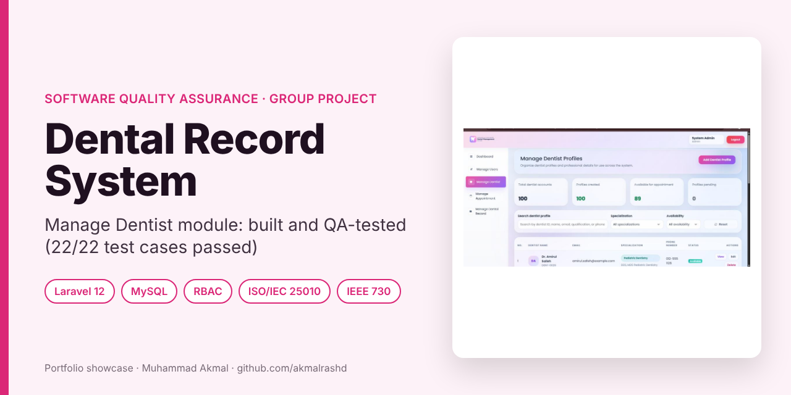
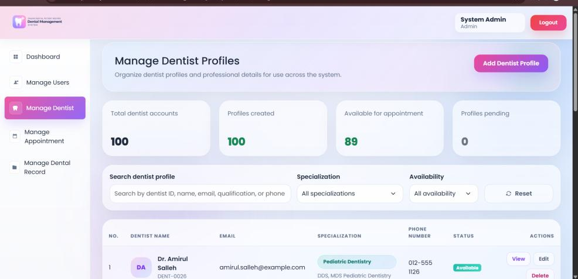
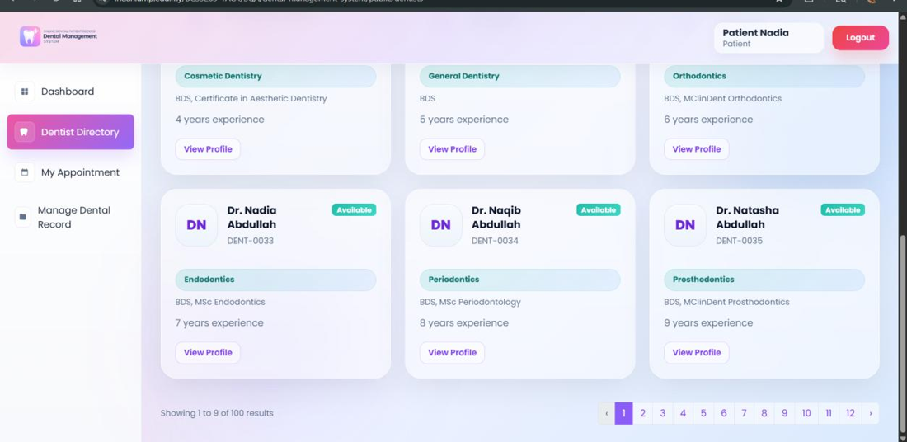
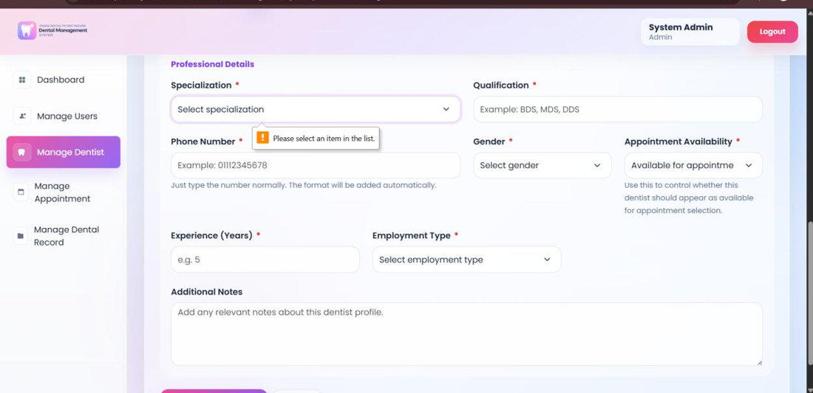
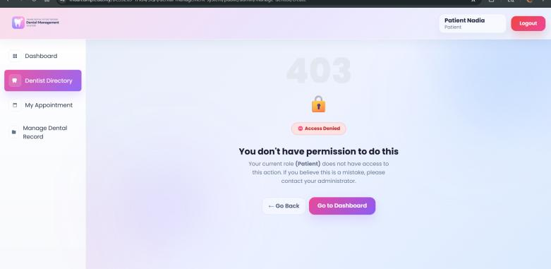
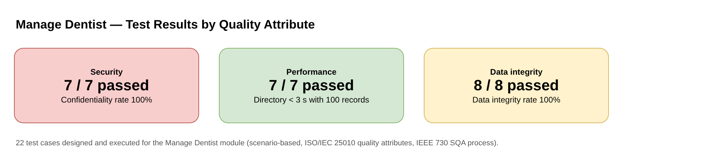
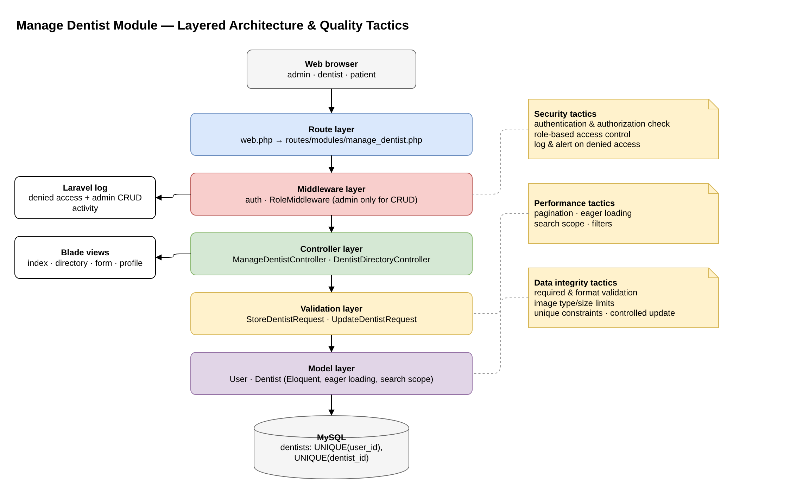
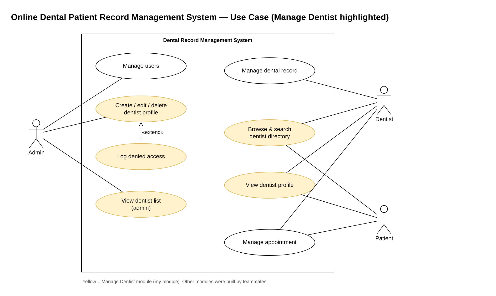

# Online Dental Patient Record Management System: Manage Dentist Module

> **Portfolio showcase** of a Software Quality Assurance (BCS3263) group project at UMPSA. I **developed and quality-tested** the *Manage Dentist* module and set up the shared Laravel base that the team built on.

**Course:** BCS3263 Software Quality Assurance, Semester 2 2025/2026 · **Group:** 1AG4  
**My role:** Developer and QA for Module 2, Manage Dentist; integration of all modules · **Period:** March – May 2026

   

---

## What I built

- **Master starter repository:** shared layout, authentication, role middleware, dashboard and one folder per module, so four teammates could work in parallel without conflicts.
- **Manage Dentist module:** admin CRUD for dentist profiles, a public **dentist directory** with search, specialisation and availability filters, and pagination; dentist self-profile.
- **Integration** of all four modules (users, dentists, appointments, dental records) into one consistent UI.

## Screenshots

  
  

  
  

Admin view · directory with pagination · required-field validation · 403 page when a patient opens an admin URL (demo data)

## Quality assurance

The QA work followed **IEEE 730** (SQA process) and **ISO/IEC 25010** (quality attributes). For the Manage Dentist module I wrote the SQA plan, quality-attribute scenarios, tactics, and the test cases below.

### Test results

### Layered architecture and where each quality tactic lives

### Use case diagram (Manage Dentist highlighted)

### Test cases (all executed, all passed)

| Attribute | What was tested | Result |
|---|---|---|
| **Security** (7) | Guest redirected to login; patient and dentist blocked from admin URLs (403); admin has full CRUD; patient sees directory only; repeated denied access logged and flagged; admin actions logged | 7/7 · confidentiality rate 100% |
| **Performance** (7) | 100 dentist records paginated; directory loads for each role; search by name/email; filter by specialisation and availability; pagination keeps filters; clear "no results" message | 7/7 · within the 3-second target |
| **Data integrity** (8) | Empty required fields rejected; invalid phone format rejected; photo limited to JPG/PNG/WebP ≤ 2 MB; duplicate `dentist_id` rejected; one profile per user (unique `user_id`); valid create and update keep the link | 8/8 · data integrity rate 100% |

### Tactics that made the tests pass

- **Security:** authentication and role middleware on every admin route; denied attempts logged with role, route, IP and time.
- **Performance:** pagination, eager loading, query scopes for search and filters.
- **Data integrity:** Form Request validation, file type/size limits, unique constraints on `user_id` and `dentist_id`.

## Process

Rapid Application Development: requirements planning → UI design in Figma → construction with testing on every build → cutover with final security, performance and integrity tests.

## Contact

**Muhammad Akmal bin Mohd Rashid**: Software Engineering student, UMPSA.  
Open to a 6-month internship (22 February to 7 August 2027).  
📧 work.akmalrashd@gmail.com · 💼 [linkedin.com/in/akmalrashd](https://www.linkedin.com/in/akmalrashd)
